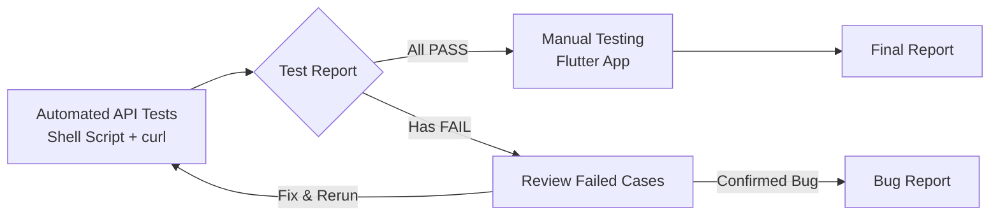

# KidsMarket — Test Plan

> Dựa trên: [Báo cáo đánh giá tổng quan dự án](file:///Users/hai/.gemini/antigravity-ide/brain/cb20e6ad-ef99-407b-95f4-08e6341993e0/implementation_plan.md) + [Requirement App Kids Market.docx](file:///Users/hai/Documents/New World/kids-market/App%20Kids%20Market.docx) + Code analysis

---

## 1. Tổng Quan

### 1.1. Mục tiêu
Kiểm thử toàn bộ tính năng **đã triển khai** của hệ thống KidsMarket, bao gồm:
- **Backend API** (Laravel): Buyer API + Seller API
- **Mobile App** (Flutter): Buyer Flow + Seller Flow

### 1.2. Phạm vi
| Trong phạm vi ✅ | Ngoài phạm vi ❌ |
|---|---|
| Buyer Authentication (login, register, social) | Chat & messaging |
| Product browsing, search, filter | Khiếu nại & Hoàn tiền |
| Cart management | Payment gateway (VNPay, Momo) |
| Order lifecycle | Tìm kiếm bằng hình ảnh |
| Review system | Admin panel |
| Shipping address CRUD | Apple Sign-In (chưa implement) |
| Seller auth, dashboard, CRUD products | Live Video |
| Seller order management | Notifications |
| Shop public info | Lưu thương hiệu yêu thích |
| Province/District geography | |
| Đa ngôn ngữ (VI/ZH) | |
| Edge cases & Security | |

### 1.3. Chiến lược kiểm thử



**Quy trình:**
1. **Chạy Automated Test** → Script tự kiểm tra tất cả API endpoints
2. **Xem Report** → Phân loại PASS / FAIL / SKIP
3. **Manual Test** → Chỉ test lại các case FAIL hoặc PASS có concerns trên Flutter app
4. **Final Report** → Tổng hợp kết quả

### 1.4. Môi trường kiểm thử

| Thành phần | Giá trị |
|---|---|
| Backend URL | `https://demo.nongsanphutho.com.vn` |
| API Base | `https://demo.nongsanphutho.com.vn/api` |
| Database | MySQL 8.0 (seeded data) |
| Buyer test account | `nguyenvana` / `password123` |
| Seller test account | `phamvanc_shop` hoặc `phamvanc@shop.com` / `password123` |
| Flutter build | Debug mode (iOS Simulator / Android Emulator) |

---

## 2. Automated Test — Hướng Dẫn Sử Dụng

### 2.1. File test script
📄 [tests/api_test.sh](file:///Users/hai/Documents/New World/kids-market/tests/api_test.sh)

### 2.2. Yêu cầu
- `bash` (macOS/Linux)
- `curl`
- `jq` (JSON parser) — cài bằng `brew install jq`

### 2.3. Cách chạy

```bash
# Sử dụng server demo (mặc định)
bash tests/api_test.sh

# Sử dụng server local
bash tests/api_test.sh http://localhost:8000

# Chỉ định URL cụ thể
bash tests/api_test.sh https://your-server.com
```

### 2.4. Output
- **Console**: Kết quả PASS/FAIL/SKIP cho từng test case theo màu
- **Log file**: `tests/api_test_report.log` — chi tiết HTTP response cho mỗi case
- **Exit code**: Số lượng test FAIL (0 = all passed)

### 2.5. Cấu hình tham số

Thay đổi các biến ở đầu script để phù hợp với data đã seed:

```bash
BUYER_USERNAME="buyer1"        # Username buyer đã tồn tại
BUYER_PASSWORD="password123"   # Password buyer
SELLER_USERNAME="seller1@kidsmarket.vn"  # Email seller
SELLER_PASSWORD="password123"  # Password seller
```

---

## 3. Danh Sách Test Cases — Automated

### 3.1. Buyer Authentication (8 cases)

| ID | Test Case | Method | Endpoint | Expected | Auto |
|---|---|---|---|---|---|
| TC-AUTH-01 | Register với data không hợp lệ (username/password ngắn) | POST | `/register` | 422, `success=false` | ✅ |
| TC-AUTH-02 | Register buyer hợp lệ | POST | `/register` | 201, `success=true` | ✅ |
| TC-AUTH-03 | Register trùng username | POST | `/register` | 422, `success=false` | ✅ |
| TC-AUTH-04 | Login sai password | POST | `/login` | 401, `success=false` | ✅ |
| TC-AUTH-05 | Login đúng → nhận token | POST | `/login` | 200, `accessToken≠null` | ✅ |
| TC-AUTH-06 | Check username đã tồn tại | GET | `/check-username` | 200, `exists=true` | ✅ |
| TC-AUTH-07 | Check username chưa tồn tại | GET | `/check-username` | 200, `exists=false` | ✅ |
| TC-AUTH-08 | Truy cập API protected không có token | GET | `/cart` | 401 | ✅ |

### 3.2. Products — Public (10 cases)

| ID | Test Case | Method | Endpoint | Expected | Auto |
|---|---|---|---|---|---|
| TC-PROD-01 | Lấy danh sách sản phẩm | GET | `/products` | 200, có data | ✅ |
| TC-PROD-02 | Lấy danh mục sản phẩm | GET | `/products/categories` | 200, array | ✅ |
| TC-PROD-03 | Tìm kiếm autocomplete | GET | `/products/search?q=a` | 200 | ✅ |
| TC-PROD-04 | Filter theo category_id | GET | `/products?category_id=X` | 200 | ✅ |
| TC-PROD-05 | Xem chi tiết sản phẩm | GET | `/products/{id}` | 200, data.id khớp | ✅ |
| TC-PROD-06 | Xem sản phẩm không tồn tại | GET | `/products/999999` | 404 | ✅ |
| TC-PROD-07 | Track view (auth) | POST | `/products/{id}/track-view` | 200 | ✅ |
| TC-PROD-08 | Toggle like (auth) | POST | `/products/{id}/like` | 200, is_liked boolean | ✅ |
| TC-PROD-09 | Recommendations (có auth) | GET | `/products/recommendations/home` | 200 | ✅ |
| TC-PROD-10 | Recommendations (không auth) | GET | `/products/recommendations/home` | 200 | ✅ |

### 3.3. Shops — Public (2 cases)

| ID | Test Case | Method | Endpoint | Expected | Auto |
|---|---|---|---|---|---|
| TC-SHOP-01 | Xem thông tin shop | GET | `/shops/{id}` | 200 | ✅ |
| TC-SHOP-02 | Xem sản phẩm của shop | GET | `/shops/{id}/products` | 200 | ✅ |

### 3.4. Provinces & Districts (3 cases)

| ID | Test Case | Method | Endpoint | Expected | Auto |
|---|---|---|---|---|---|
| TC-GEO-01 | Danh sách tỉnh/thành | GET | `/provinces` | 200 | ✅ |
| TC-GEO-02 | Chi tiết tỉnh | GET | `/provinces/{id}` | 200 | ✅ |
| TC-GEO-03 | Quận/huyện theo tỉnh | GET | `/provinces/{id}/districts` | 200 | ✅ |

### 3.5. Shipping Addresses — Auth Required (5 cases)

| ID | Test Case | Method | Endpoint | Expected | Auto |
|---|---|---|---|---|---|
| TC-ADDR-01 | Lấy danh sách địa chỉ | GET | `/shipping-addresses` | 200 | ✅ |
| TC-ADDR-02 | Tạo địa chỉ mới | POST | `/shipping-addresses` | 201 | ✅ |
| TC-ADDR-03 | Cập nhật địa chỉ | PUT | `/shipping-addresses/{id}` | 200 | ✅ |
| TC-ADDR-04 | Đặt địa chỉ mặc định | PATCH | `/shipping-addresses/{id}/set-default` | 200 | ✅ |
| TC-ADDR-05 | Xóa địa chỉ | DELETE | `/shipping-addresses/{id}` | 200 | ✅ |

### 3.6. Cart — Auth Required (3 cases)

| ID | Test Case | Method | Endpoint | Expected | Auto |
|---|---|---|---|---|---|
| TC-CART-01 | Xem giỏ hàng | GET | `/cart` | 200 | ✅ |
| TC-CART-02 | Cập nhật giỏ hàng (thêm item) | POST | `/cart` | 200 | ✅ |
| TC-CART-03 | Giỏ hàng có item sau khi update | GET | `/cart` | 200, items.length > 0 | ✅ |

### 3.7. Orders — Auth Required (7 cases)

| ID | Test Case | Method | Endpoint | Expected | Auto |
|---|---|---|---|---|---|
| TC-ORDER-01 | Tạo đơn hàng | POST | `/orders` | 201 | ✅ |
| TC-ORDER-02 | Lấy danh sách đơn | GET | `/orders` | 200 | ✅ |
| TC-ORDER-03 | Filter đơn theo status | GET | `/orders?status=pending` | 200 | ✅ |
| TC-ORDER-04 | Chi tiết đơn hàng | GET | `/orders/{id}` | 200, status=pending | ✅ |
| TC-ORDER-05 | Hủy đơn hàng | PATCH | `/orders/{id}/cancel` | 200, status=cancelled | ✅ |
| TC-ORDER-06 | Hủy đơn đã hủy → lỗi | PATCH | `/orders/{id}/cancel` | 422 | ✅ |
| TC-ORDER-07 | Xem đơn không tồn tại | GET | `/orders/999999` | 404 | ✅ |

### 3.8. Reviews (4 cases)

| ID | Test Case | Method | Endpoint | Expected | Auto |
|---|---|---|---|---|---|
| TC-REVIEW-01 | Xem đánh giá sản phẩm (public) | GET | `/products/{id}/reviews` | 200 | ✅ |
| TC-REVIEW-02 | Gửi đánh giá (auth) | POST | `/products/{id}/reviews` | 201 hoặc 409 | ✅ |
| TC-REVIEW-03 | Gửi đánh giá không auth → 401 | POST | `/products/{id}/reviews` | 401 | ✅ |
| TC-REVIEW-04 | Gửi đánh giá rating > 5 → 422 | POST | `/products/{id}/reviews` | 422 | ✅ |

### 3.9. Seller Authentication (4 cases)

| ID | Test Case | Method | Endpoint | Expected | Auto |
|---|---|---|---|---|---|
| TC-SELLER-AUTH-01 | Đăng ký seller | POST | `/seller/auth/register` | 201 | ✅ |
| TC-SELLER-AUTH-02 | Đăng nhập seller | POST | `/seller/auth/login` | 200 | ✅ |
| TC-SELLER-AUTH-03 | Login sai thông tin → 401 | POST | `/seller/auth/login` | 401 | ✅ |
| TC-SELLER-AUTH-04 | Buyer token truy cập seller → 403 | GET | `/seller/dashboard` | 403 | ✅ |

### 3.10. Seller API — Auth Required (8 cases)

| ID | Test Case | Method | Endpoint | Expected | Auto |
|---|---|---|---|---|---|
| TC-SELLER-01 | Dashboard stats | GET | `/seller/dashboard` | 200 | ✅ |
| TC-SELLER-02 | Thông tin shop | GET | `/seller/shop` | 200 | ✅ |
| TC-SELLER-03 | Danh sách sản phẩm seller | GET | `/seller/products` | 200 | ✅ |
| TC-SELLER-04 | Chi tiết sản phẩm seller | GET | `/seller/products/{id}` | 200 | ✅ |
| TC-SELLER-05 | Danh sách đơn hàng seller | GET | `/seller/orders` | 200 | ✅ |
| TC-SELLER-06 | Chi tiết đơn hàng seller | GET | `/seller/orders/{id}` | 200 | ✅ |
| TC-SELLER-07 | Danh sách reviews seller | GET | `/seller/reviews` | 200 | ✅ |
| TC-SELLER-08 | Seller logout | POST | `/seller/auth/logout` | 200 | ✅ |

### 3.11. Edge Cases & Security (5 cases)

| ID | Test Case | Method | Endpoint | Expected | Auto |
|---|---|---|---|---|---|
| TC-EDGE-01 | JWT token không hợp lệ | GET | `/cart` | 401 | ✅ |
| TC-EDGE-02 | Auth header rỗng | GET | `/orders` | 401 | ✅ |
| TC-EDGE-03 | SQL Injection trong search | GET | `/products/search` | 200 (safe) | ✅ |
| TC-EDGE-04 | XSS trong review comment | POST | `/products/{id}/reviews` | 201/409/422 (safe) | ✅ |
| TC-EDGE-05 | Input rất dài (500 chars) | GET | `/products/search` | 200/414/422 | ✅ |

**Tổng automated tests: ~59 cases**

---

## 4. Manual Test Cases — Flutter App

> Chỉ thực hiện **SAU KHI** có kết quả automated test. Ưu tiên test lại các case FAIL hoặc PASS có concerns.

### 4.1. Login & Navigation

| ID | Test Case | Bước thực hiện | Kỳ vọng |
|---|---|---|---|
| MT-01 | Login bằng username/password | 1. Mở app → Login screen<br>2. Nhập `buyer1` / `password123`<br>3. Nhấn Đăng nhập | Chuyển sang MainBuyer, hiển thị HomeTab |
| MT-02 | Login bằng Google | 1. Nhấn icon Google<br>2. Chọn tài khoản Google | Đăng nhập thành công, vào MainBuyer |
| MT-03 | Login bằng Facebook | 1. Nhấn icon Facebook<br>2. Đăng nhập Facebook | Đăng nhập thành công |
| MT-04 | Login sai thông tin | 1. Nhập sai username/password<br>2. Nhấn Đăng nhập | Hiển thị snackbar lỗi |
| MT-05 | Bottom navigation | Nhấn lần lượt các tab: Trang chủ, Live, Thông báo, Tôi | Tab chuyển đổi mượt, icon active đổi màu |

### 4.2. Product Browsing

| ID | Test Case | Bước thực hiện | Kỳ vọng |
|---|---|---|---|
| MT-06 | Tìm kiếm sản phẩm | 1. Nhập từ khóa vào search<br>2. Chờ suggestions hiện | Dropdown suggestions xuất hiện dưới search bar |
| MT-07 | Xem chi tiết sản phẩm | 1. Nhấn vào 1 ProductCard<br>2. Cuộn xem thông tin | Hiển thị ảnh, giá, biến thể, mô tả, nhà cung cấp |
| MT-08 | Like sản phẩm | Nhấn nút Like/Tim trong ProductDetail | Icon đổi trạng thái, like_count cập nhật |
| MT-09 | Xem shop nhà cung cấp | Nhấn "Xem shop" trong ProductDetail | Chuyển sang Supplier screen, có sản phẩm của shop |
| MT-10 | Pull-to-refresh | Kéo xuống ở HomeTab | Danh sách sản phẩm reload |

### 4.3. Cart & Order

| ID | Test Case | Bước thực hiện | Kỳ vọng |
|---|---|---|---|
| MT-11 | Thêm vào giỏ hàng | 1. Vào ProductDetail<br>2. Chọn biến thể<br>3. Chọn SL<br>4. Nhấn thêm giỏ | Thông báo thành công, badge cart tăng |
| MT-12 | Xem giỏ hàng | Nhấn icon giỏ hàng ở header | CartScreen hiển thị sản phẩm đã thêm |
| MT-13 | Checkout + Đặt hàng | 1. Chọn sản phẩm trong cart<br>2. Nhấn mua<br>3. Chọn địa chỉ<br>4. Xác nhận | Đặt hàng thành công, cart xóa item đã mua |
| MT-14 | Xem danh sách đơn hàng | Vào Profile → Đơn hàng của tôi | Hiển thị đơn hàng theo tab status |
| MT-15 | Xem chi tiết đơn hàng | Nhấn vào 1 đơn hàng | OrderDetail hiển thị sản phẩm, địa chỉ, trạng thái |
| MT-16 | Hủy đơn hàng | Nhấn hủy đơn hàng pending | Đơn chuyển sang "Đã hủy" |

### 4.4. Shipping Address

| ID | Test Case | Bước thực hiện | Kỳ vọng |
|---|---|---|---|
| MT-17 | Thêm địa chỉ | Profile → Settings → AddressForm | Tạo thành công, hiển thị trong danh sách |
| MT-18 | Sửa địa chỉ | Nhấn sửa trên 1 địa chỉ | Cập nhật thành công |
| MT-19 | Đặt mặc định | Nhấn "Đặt mặc định" | Chỉ 1 địa chỉ mặc định |
| MT-20 | Xóa địa chỉ | Nhấn xóa | Xóa thành công, nếu xóa mặc định thì chuyển sang cái khác |

### 4.5. Seller Mode

| ID | Test Case | Bước thực hiện | Kỳ vọng |
|---|---|---|---|
| MT-21 | Chuyển sang Seller | Login bằng seller → Profile → "Shop của tôi" | MainSeller hiển thị MallTab với stats |
| MT-22 | CRUD sản phẩm | Seller → Products → Thêm mới/Sửa/Xóa | Tạo/sửa/xóa thành công |
| MT-23 | Quản lý đơn hàng seller | Seller → Orders | Hiển thị đơn hàng buyer đã đặt |
| MT-24 | Quay lại Buyer mode | Profile → "Quay lại" | Chuyển về MainBuyer |

### 4.6. Đa ngôn ngữ

| ID | Test Case | Bước thực hiện | Kỳ vọng |
|---|---|---|---|
| MT-25 | Chuyển tiếng Trung | Settings → Language → 中文 | Toàn bộ UI chuyển sang tiếng Trung |
| MT-26 | Chuyển tiếng Việt | Settings → Language → Tiếng Việt | Toàn bộ UI chuyển sang tiếng Việt |

---

## 5. Quy Trình Chạy Test

### Bước 1: Chạy Automated Test

```bash
cd /Users/hai/Documents/New\ World/kids-market
bash tests/api_test.sh
```

### Bước 2: Đọc Report

- Xem kết quả trên console (màu sắc PASS/FAIL)
- Mở `tests/api_test_report.log` để xem chi tiết HTTP response
- Ghi nhận các case **FAIL** và **SKIP**

### Bước 3: Manual Test (nếu cần)

- Test lại các case FAIL trên Flutter app
- Kiểm tra UI/UX cho các flow đã pass automated nhưng cần verify trải nghiệm người dùng
- Ghi nhận bugs vào Bug Report

### Bước 4: Re-run sau khi fix

```bash
# Chạy lại toàn bộ
bash tests/api_test.sh

# Hoặc chỉ chạy với local server sau khi fix
bash tests/api_test.sh http://localhost:8000
```

---

## 6. Tiêu Chí Đánh Giá

| Mức độ | Pass Rate | Đánh giá |
|---|---|---|
| 🟢 Excellent | ≥ 95% | Sẵn sàng release |
| 🟡 Good | 85-94% | Cần fix minor bugs |
| 🟠 Fair | 70-84% | Cần fix trước khi release |
| 🔴 Poor | < 70% | Cần review lại toàn bộ |
